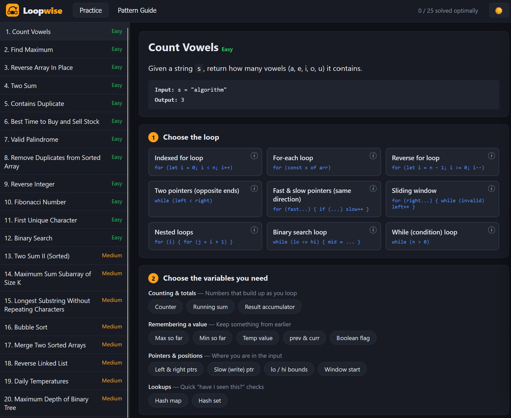

<p align="center">
  
</p>

<h1 align="center">Loopwise</h1>

<p align="center">
  Struggling with DSA problems? See the loop run, then pick the best one.<br />
  <a href="https://taifatang.github.io/loopwise/"><b>Visit the Webiste</b></a>
</p>



## Who it's for
Loopwise is for people who get stuck on DSA and LeetCode-style problems, especially when the hard part is knowing **which loop to write** (indexed `for`, `while`, two pointers, sliding window, binary search, nested loops and so on) and **which variables to keep track of**.

Instead of typing code, you choose a loop pattern and the variables you think you need. Then you can:

- **Visualise the loop.** Step through your own choice on an example input and watch each iteration and variable update. A missing variable shows up as a gap, and an unused one is flagged.
- **Find the best loop.** Get told whether your choice is optimal, works but isn't the best, is missing variables, or is the wrong loop, so you learn why one approach beats another.
- **Learn the signals.** The Pattern Guide shows which words in a problem point to which loop, with animated demos.

## Run
Open `index.html` in a browser, or serve it:

```bash
python3 -m http.server 8000   # then open http://localhost:8000
```
